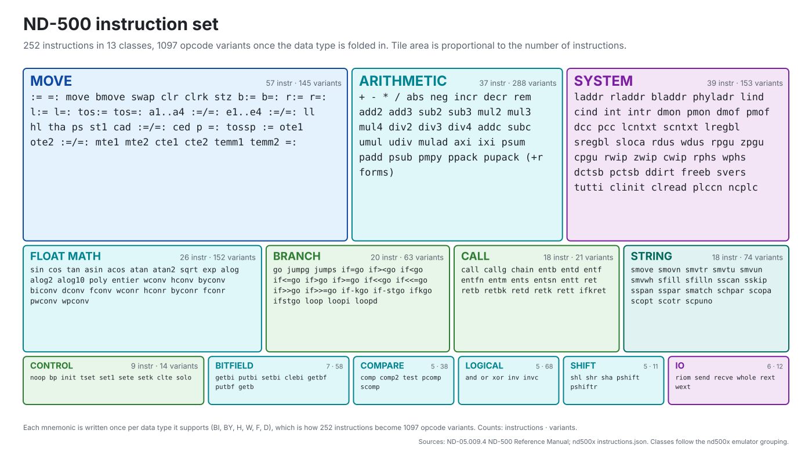
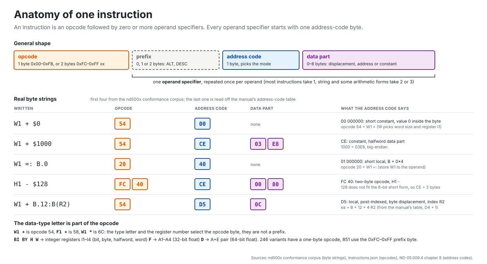
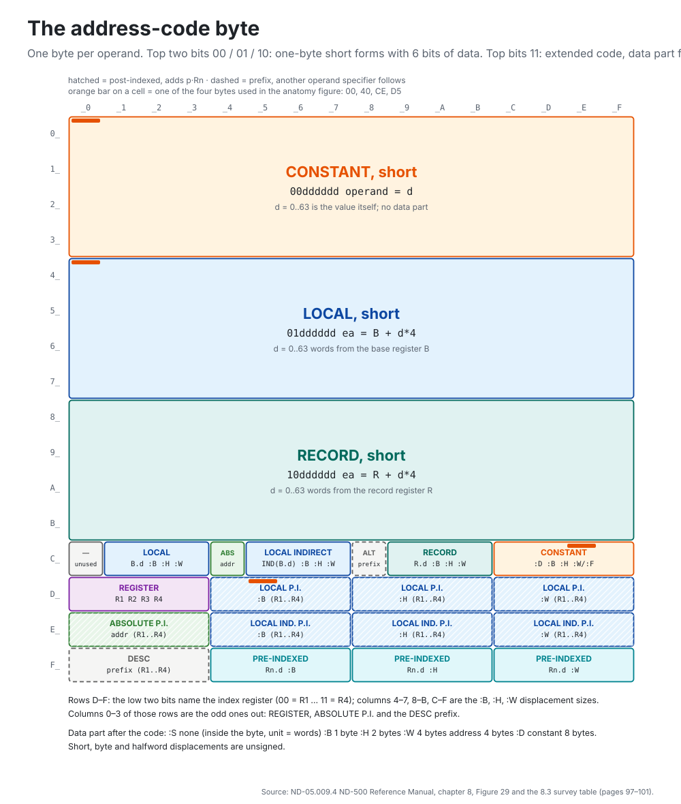
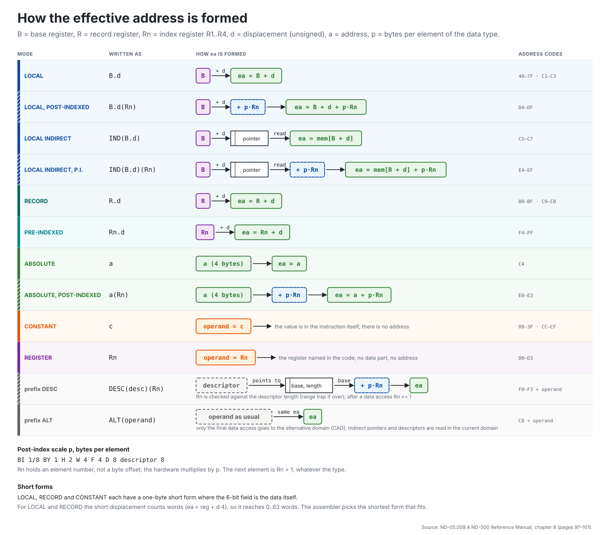

# ND-500 instruction set overview

Four figures that show what the ND-500 asks of a program: which instructions
exist, how one is encoded, what the address-code byte can say, and what each
addressing mode does with it. They are generated by
[tools/gen_isa_figures.py](../tools/gen_isa_figures.py) from
[instructions.json](instructions/instructions.json), the conformance corpus
and the reference manual, and regenerated when the opcode table changes. The
[opcode matrix](instructions/OPCODE-MATRIX.md) shows every opcode in one view.

In the early 1980s the processors of the day could be lined up by how much
they expected to understand. At one end the first RISC chips: thirty-odd
instructions, all the same length, memory touched only to load and store. In
the middle the microprocessors people actually bought, the 68000 and 8086, with
a few dozen operations and a dozen ways to find an operand. At the far end
DEC's VAX, with some three hundred instructions, nine data types and operands
that each carried their own addressing byte.

The ND-500 stands at that far end, beside the VAX. Its 241 instructions in 13
families come in six data types, over a thousand opcodes in all, with ten ways
of addressing an operand and two prefixes that stack on top. Sines, logarithms,
decimal arithmetic and hardware bounds checks are single instructions, and one
prefix byte lets a routine reach into the memory of the protected domain that
called it.

## 1. The instruction set

241 instructions in 13 classes; tile area is proportional to the instruction
count. The same mnemonic exists once per data type (BI, BY, H, W, F, D), which
is how 241 becomes 1,078 opcodes. The class split is the one the emulator uses
(`src/cpu/instructions/<CLASS>/`), not the manual's chapter order. Every
mnemonic links to its own page from the [instruction index](instructions/ALL-INSTRUCTIONS.md).

## 2. Anatomy of one instruction

The general shape (opcode, then per operand a prefix, an address-code byte and
a data part) and five real byte strings. `W1 + $0`, `W1 + $1000`, `W1 =: B.0`
and `H1 - $128` are cases in the conformance corpus; `W1 + B.12:B(R2)` is read
off the manual's address-code table (D4 + 1 for R2, byte displacement 12).

## 3. The address-code byte

All 256 values of the byte that starts every operand specifier. Three quarters
are the one-byte short forms; the last quarter holds the extended codes. The
orange bars mark the four bytes used in the anatomy figure. Code `C0` is not
listed in the manual's survey table and the emulator treats it as unknown.

## 4. How the effective address is formed

One drawing per mode: the register it starts from, the displacement, the memory
read for the indirect modes, the post-index step, and the result. The two
prefixes sit at the bottom.

## Sources

- Address codes, formulas, prefixes, post-index scale and data-part sizes:
  [ND-05.009.4 ND-500 Reference Manual](ND-05.009.4%20EN%20ND-500%20Reference%20Manual.md),
  chapter 8, pages 97-101 (Figure 29 and the 8.3 survey table).
- Instruction and variant counts, class grouping, mnemonics and opcode bytes:
  [instructions.json](instructions/instructions.json) (1,078 entries, 241
  distinct instructions, 13 classes).
- Byte strings: [test/nd500-conformance.json](../test/nd500-conformance.json).
- The VAX, 68000, 8086 and RISC figures in the opening paragraphs are rounded
  general knowledge, not taken from a document in this repository.
